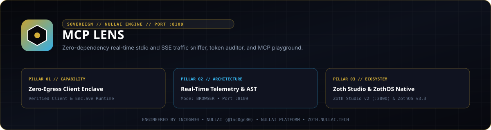

# MCP Lens



**MCP Lens** (`mcp-lens`) is a zero-dependency Python 3.9+ traffic sniffer, BPE token-weight schema auditor, JSON Schema minifier, and web workstation (`127.0.0.1:8109`) for the Model Context Protocol (MCP). It wraps any child MCP stdio process transparently while streaming JSON-RPC 2.0 frames over Server-Sent Events (`/api/events/stream`) for real-time inspection and replay.

- **Zoth Studio v2 Dossier**: [https://zoth.nullai.tech/tools/mcp-lens](https://zoth.nullai.tech/tools/mcp-lens)
- **Repository**: [https://github.com/1nc0gn30/mcp-lens](https://github.com/1nc0gn30/mcp-lens)
- **Default Loopback Endpoint**: `http://127.0.0.1:8109`

---

## Overview

Large MCP tool registries can consume thousands of context-window tokens per conversation turn before any tool is called. `mcp-lens` instruments MCP servers without modifying client or server source code:

- **Transparent Stdio Proxy (`StdioProxy`)**: Wraps any child MCP command (`mcp-lens proxy -- <cmd>`), tapping inbound/outbound newline-delimited JSON-RPC 2.0 frames with zero protocol mutation.
- **BPE Token Estimator (`MCPTrafficAnalyzer`)**: Computes token overhead across `initialize`, `tools/list`, `tools/call`, `resources/read`, and `prompts/get` payloads.
- **Lossless Schema Minifier (`SchemaMinifier`)**: Strips redundant schema boilerplate, verbose examples, and bloated property descriptions while preserving JSON Schema structural constraints (`type`, `properties`, `required`, `enum`), quantifying exact token savings.
- **Interactive Tool Replay (`/api/replay`)**: Test and replay MCP `tools/call` payloads directly from the browser cockpit or REST API.

---

## Architecture

```text
MCP Host Client (Claude Code / Cursor / ZothOS)
       │  JSON-RPC 2.0 over stdio
       ▼
  mcp-lens StdioProxy ──► POST /api/frame ──► MCPLensServer (127.0.0.1:8109)
       │                                           ├── TrafficStore ring buffer
       ▼                                           ├── MCPTrafficAnalyzer + SchemaMinifier
  Child MCP Server                                 └── SSE /api/events/stream + Web UI
```

---

## Quickstart

```bash
git clone https://github.com/1nc0gn30/mcp-lens.git
cd mcp-lens
python3 -m pip install -e .

# Launch the Web Cockpit & Telemetry Server on 127.0.0.1:8109
mcp-lens serve --host 127.0.0.1 --port 8109
```

Or run directly from the repository checkout:

```bash
python3 server.py serve --port 8109
```

Open `http://127.0.0.1:8109` in your browser.

---

## CLI & ZothOS v3.4.0 Integration

`mcp-lens` supports standalone server mode, transparent stdio proxying, health telemetry, and built-in self-diagnostics:

```bash
# Wrap a child MCP server and stream frames to 127.0.0.1:8109
mcp-lens proxy --port 8109 -- npx -y @modelcontextprotocol/server-filesystem /tmp

# Shorthand proxy invocation (headless stdio only, no HTTP server)
mcp-lens --no-server -- python3 my_mcp_server.py

# Inspect live daemon status and token savings
mcp-lens --status
mcp-lens --json
mcp-lens status --port 8109 --json

# Run built-in JSON-RPC parser, token estimator, and schema minifier self-tests
mcp-lens test
```

---

## REST API Reference

Mutating `POST` routes enforce local-origin validation (`127.0.0.1`, `localhost`, `[::1]`, or non-browser CLI callers).

| Method | Endpoint | Description |
| :--- | :--- | :--- |
| `GET` | `/` | Web cockpit (`public/index.html`) |
| `GET` | `/health`, `/api/health` | Service health and uptime in seconds |
| `GET` | `/api/stats` | Frame count, bytes streamed, discovered tools, raw token overhead, and minification savings |
| `GET` | `/api/traffic?limit=100&topic=tools/call` | Recent captured JSON-RPC 2.0 frames with optional method filter |
| `GET` | `/api/tools` | Per-tool token audit (`total_tokens_raw`, `total_tokens_saved`, `overall_savings_percent`) |
| `GET` | `/api/events/stream` | Real-time Server-Sent Events (SSE) frame stream |
| `POST` | `/api/minify` | Minify an MCP tool JSON schema (`{"tool": {...}}`) and return token delta |
| `POST` | `/api/replay` | Replay/simulate a `tools/call` invocation (`{"tool_name": "...", "arguments": {...}}`) |
| `POST` | `/api/frame` | Ingest a tapped JSON-RPC frame (`{"direction": "inbound", "raw_line": "..."}`) |

---

## Testing & Verification

```bash
PYTHONPATH=src python3 -m pytest -q
./bin/mcp-lens --help
./bin/mcp-lens test
./bin/mcp-lens --json
```

---

## Support & License

100% free and open-source software under the MIT License.

- Optional support: [Buy Us a Coffee via Stripe](https://buy.stripe.com/3cIfZg27PdKo2D64Ocfw40X)
- Engineered by **1nc0gn30** (`@1nc0gn30`, [https://1nc0gn30.si](https://1nc0gn30.si)) • **NullAI** ([https://nullai.tech](https://nullai.tech))
