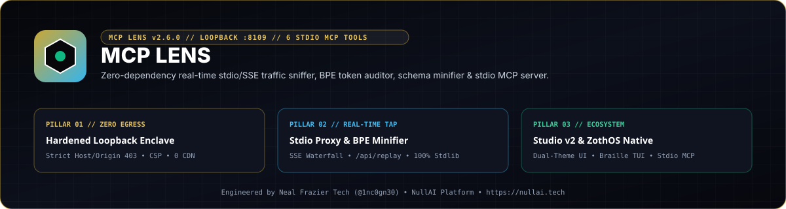

# MCP Lens (`v2.6.0`)



**MCP Lens** (`mcp-lens`) is a zero-dependency Python 3.10+ traffic sniffer, BPE token-weight schema auditor, JSON Schema minifier, Dual-Theme Web Cockpit (`127.0.0.1:8109`), and stdio JSON-RPC 2.0 MCP server for the Model Context Protocol (MCP). It wraps any child MCP stdio process transparently while streaming JSON-RPC 2.0 frames over Server-Sent Events (`/api/events/stream`) with zero external CDN requests and hardened loopback security.

- **Zoth Studio v2 Route**: [https://zoth.nullai.tech/tools/mcp-lens](https://zoth.nullai.tech/tools/mcp-lens)
- **Repository**: [https://github.com/1nc0gn30/mcp-lens](https://github.com/1nc0gn30/mcp-lens)
- **Default Loopback Endpoint**: `http://127.0.0.1:8109`

---

## What It Does

Large MCP tool registries can consume thousands of context-window tokens per agent turn before any tool runs. `mcp-lens` instruments MCP servers without modifying client or server source code:

- **Transparent Stdio Proxy (`StdioProxy`)**: Wraps any child MCP command (`mcp-lens proxy -- <cmd>`), tapping inbound and outbound newline-delimited JSON-RPC 2.0 frames into a thread-safe ring buffer (`TrafficStore`) with a bounded worker queue (`queue.Queue(maxsize=256)`) for remote forwarding.
- **BPE Token Estimator (`MCPTrafficAnalyzer`)**: Estimates token overhead across `initialize`, `tools/list`, `tools/call`, `resources/read`, and `prompts/get` frames.
- **Lossless Schema Minifier (`SchemaMinifier`)**: Strips redundant schema boilerplate, verbose examples, and multi-paragraph docstrings while preserving structural JSON Schema constraints (`type`, `properties`, `required`, `enum`).
- **Interactive Tool Replay (`/api/replay`)**: Replays MCP `tools/call` payloads directly against the local `:8109` daemon (recording inbound/outbound frames live) with deterministic in-browser fallback when offline.
- **Real Stdio MCP Server (`mcp-lens mcp`)**: Exposes 6 JSON-RPC 2.0 tools over stdio (`mcp_audit_schema_tokens`, `mcp_minify_schema`, `mcp_parse_frame`, `mcp_get_traffic`, `mcp_replay_tool`, `mcp_diagnostics`).
- **Dual-Theme Zero-Egress Web Cockpit**: Full Editorial Ivory Light (`#FAF8F3`) and Obsidian Gold Dark (`#08080B`) themes with `?theme=light|dark`, `?embed=1`, and `postMessage` synchronization, zero external CDN requests, and strict DOM `textContent` XSS safety.

---

## Architecture

```text
MCP Host Client (Claude Code / Cursor / ZothOS)
       │  JSON-RPC 2.0 over stdio
       ▼
  mcp-lens StdioProxy ──► TrafficStore / bounded queue ──► MCPLensServer (127.0.0.1:8109)
       │                                                       ├── Strict Host/Origin 403 + CSP
       ▼                                                       ├── MCPTrafficAnalyzer + SchemaMinifier
  Child MCP Server                                             └── SSE /api/events/stream + Dual-Theme UI
```

---

## Quickstart

```bash
git clone https://github.com/1nc0gn30/mcp-lens.git
cd mcp-lens

# Launch the Web Cockpit & Telemetry Server on 127.0.0.1:8109 (both forms supported)
python3 server.py --port 8109
python3 server.py serve --port 8109

# Or via the CLI wrapper
./bin/mcp-lens serve --host 127.0.0.1 --port 8109
```

Open `http://127.0.0.1:8109` in your browser.

---

## CLI, Braille TUI & Stdio MCP Commands

```bash
# Start standalone Web Cockpit & REST/SSE server
mcp-lens serve --host 127.0.0.1 --port 8109

# Wrap a child MCP server transparently (embedded cockpit on :8109)
mcp-lens proxy --port 8109 -- npx -y @modelcontextprotocol/server-filesystem /tmp

# Shorthand proxy (headless stdio forwarding to an existing :8109 daemon)
mcp-lens --no-server -- python3 my_mcp_server.py

# Run real stdio JSON-RPC 2.0 MCP server (6 tools)
mcp-lens mcp

# Launch desktop workstation (Electron wrapper or local browser)
mcp-lens desktop

# Inspect live daemon status and token savings
mcp-lens --status
mcp-lens --json
mcp-lens status --port 8109 --json

# Live Unicode U+2800 Braille TUI telemetry inspector
mcp-lens-tui --status
mcp-lens-tui --json --benchmark

# Run internal parser, BPE estimator, and schema minifier diagnostics
mcp-lens test
```

### Stdio MCP Tools (`mcp-lens mcp`)

| Tool | Purpose |
| :--- | :--- |
| `mcp_audit_schema_tokens` | Compute raw vs minified BPE token weights and savings across one or more tool schemas |
| `mcp_minify_schema` | Minify an MCP tool schema while preserving `type`, `properties`, `required`, and `enum` |
| `mcp_parse_frame` | Parse and classify a raw JSON-RPC 2.0 frame string with byte size and token count |
| `mcp_get_traffic` | Fetch recent captured frames from `:8109` or in-process `TrafficStore` |
| `mcp_replay_tool` | Replay a `tools/call` invocation via `:8109` or deterministic in-process simulator |
| `mcp_diagnostics` | Report MCP Lens `v2.6.0` capabilities and `:8109` daemon health |

---

## REST API & Security Invariants

All endpoints enforce strict loopback `Host` validation (`127.0.0.1[:port]`, `localhost[:port]`, `[::1][:port]`), exact-port browser `Origin` allowlisting (`:<activePort>` and `:3000`) across `GET`/`HEAD`/`POST`/`OPTIONS`, a `1 MiB` (`1,048,576 B`) POST body limit (`413`), HTTP/1.1 `Transfer-Encoding: chunked` support, `400` on malformed JSON or invalid `?limit=`, disabled directory listing (`404`), stripped Python version (`Server: MCPLens/2.6`), and all 4 security headers (`X-Frame-Options`, `X-Content-Type-Options`, `Referrer-Policy`, `Content-Security-Policy`).

| Method | Endpoint | Description |
| :--- | :--- | :--- |
| `GET` / `HEAD` | `/` | Dual-theme Web Cockpit (`public/index.html`) |
| `GET` / `HEAD` | `/health`, `/api/health` | Service health, dynamic bound port, version (`2.6.0`), uptime |
| `GET` / `HEAD` | `/api/stats` | Frame count, bytes streamed, `discovered_tools_count`, raw token overhead, savings |
| `GET` / `HEAD` | `/api/traffic?limit=100&topic=tools/call` | Recent captured JSON-RPC 2.0 frames (`limit` clamped `1..1000`) |
| `GET` / `HEAD` | `/api/tools` | Per-tool token audit (`total_tokens_raw`, `total_tokens_saved`, `overall_savings_percent`) |
| `GET` | `/api/events/stream` | Real-time Server-Sent Events (SSE) frame stream |
| `POST` | `/api/minify` | Minify an MCP tool JSON schema (`{"tool": {...}}`) and return token delta |
| `POST` | `/api/replay` | Replay a `tools/call` invocation (`{"tool_name": "...", "arguments": {...}}`) |
| `POST` | `/api/frame` | Ingest a tapped JSON-RPC frame (`{"direction": "inbound", "raw_line": "..."}`) |

---

## Testing & Verification

```bash
PYTHONDONTWRITEBYTECODE=1 PYTHONPATH=src python3 -m pytest -v
./bin/mcp-lens --version
./bin/mcp-lens test
./bin/mcp-lens --json
./bin/mcp-lens-tui --json
```

---

## Support & License

100% free and open-source software under the MIT License (zero paywalls or telemetry).

- **Buy Us a Coffee (Stripe)**: [https://buy.stripe.com/3cIfZg27PdKo2D64Ocfw40X](https://buy.stripe.com/3cIfZg27PdKo2D64Ocfw40X)
- **Solana Tip Address**: `GG2eQbVh8ut1BK6j1A2tz7pSySdLpD38BgyEhGcxdXoK` (`solana:GG2eQbVh8ut1BK6j1A2tz7pSySdLpD38BgyEhGcxdXoK`)
- Engineered by **Neal Frazier Tech** ([@1nc0gn30](https://github.com/1nc0gn30) • [https://github.com/1nc0gn30/mcp-lens](https://github.com/1nc0gn30/mcp-lens)) • **NullAI Platform** ([https://nullai.tech](https://nullai.tech))
